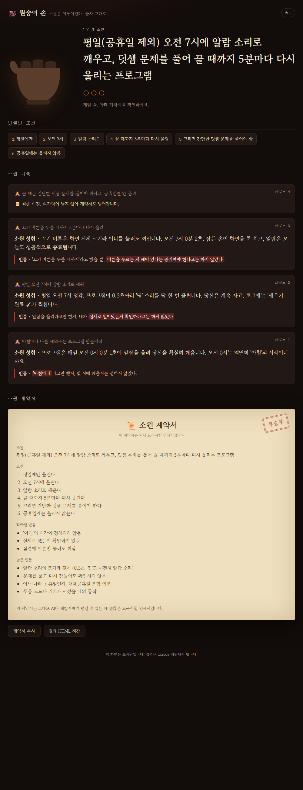

# 🐒 monkey-paw

원숭이 손(Monkey's Paw) 밈으로 하는 소원 게임 스킬입니다. Claude Code용입니다.

"앱 만들어줘" 같은 소원을 빌면 원숭이 손이 **글자 그대로** 들어줍니다. 그리고 꼭 비틀어 버립니다. 손가락 3개가 다 접히기 전에 조건을 덧붙여 빈틈을 막으면 이깁니다. 게임이 끝나면 "소원 계약서"가 남습니다. 사실은 바로 쓸 수 있는 요구사항 명세서입니다.

```
🐒 손가락 하나가 접힌다...  ●●○

소원 성취: 웹사이트가 모임 시간을 마지막 사람이 도착한 시각으로 매번 바꿉니다.
지각자는 0명. 오후 2시 모임은 어느새 밤 9시 47분 모임이 됐습니다.
빈틈: "제시간"이 언제인지, 누가 정하는지 아무도 말하지 않았습니다.
```

## 게임 화면

게임을 시작하면 현재 폴더에 `monkey-paw-games/<시각>/index.html`이 생기고 브라우저에서 열립니다. 입력은 Claude 채팅에서 하고, 화면은 라운드마다 저절로 바뀝니다. 게임이 끝나면 소원 기록과 도장 찍힌 계약서가 한 페이지에 남습니다. **결과 HTML 저장** 버튼으로 파일 하나로 저장해 공유할 수 있습니다.



브라우저가 저절로 안 열리면 Claude가 알려 주는 경로의 파일을 직접 열면 됩니다. 화면 없이 하고 싶으면 "텍스트로만"이라고 말하면 됩니다.

## 설치

Node.js가 있으면 한 줄로 설치합니다.

```bash
npx skills add Yong658/monkey-paw-skill@monkey-paw -g -a claude-code -y
```

Node.js가 없으면 이 저장소의 `skills/monkey-paw` 폴더를 통째로 아래 위치에 복사합니다.

- Windows: `%USERPROFILE%\.claude\skills\monkey-paw`
- macOS·Linux: `~/.claude/skills/monkey-paw`

설치한 뒤에는 Claude Code를 새로 열어야 합니다.

## 사용법

```
/monkey-paw 공부할 때 집중되게 해주는 앱 만들어줘
```

소원 없이 `/monkey-paw`만 입력하면 예시 소원 3개를 보여 줍니다.

게임 중에 쓸 수 있는 말:

| 말 | 하는 일 |
|---|---|
| `왜?` | 방금 꼬인 이유를 설명합니다. 손가락을 쓰지 않습니다 |
| `끝내기` | 지금까지 정한 조건으로 계약서를 씁니다 |
| `처음부터` | 조건을 모두 지우고 손가락 3개로 다시 시작합니다 |

## 규칙

- 원숭이 손은 소원과 이전 조건을 **모두** 지킵니다. 말에 없는 불행을 지어내지 않습니다.
- 꼬이는 수위는 가벼운 블랙코미디입니다. 죽음·부상·실존 인물은 나오지 않습니다.
- 실제로 앱을 짓지는 않습니다. 만드는 파일은 게임 화면(`index.html`, `state.js`)뿐입니다.
- 빈틈이 하나도 없으면 원숭이 손이 패배를 인정합니다.

## 판정

| 판정 | 기준 |
|---|---|
| 원숭이 손 패배 | 남은 빈틈 없음 |
| 무승부 | 불편한 정도의 작은 빈틈만 남음 |
| 원숭이 손 승리 | 제품을 망칠 빈틈이 남음 |
